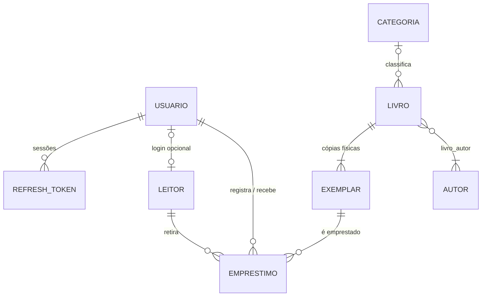

# LibreLeitura — Arquitetura de ponta a ponta

Sistema web para pequenas bibliotecas e salas de leitura: cadastro de livros e leitores, empréstimos, devoluções, consulta pública do acervo e alertas de prazos vencidos.

Este repositório contém o **backend** (API REST em Python). O **frontend** (SPA hospedada no S3) é desenvolvido por outra parte da equipe; a seção [Contrato com o frontend](#8-contrato-com-o-frontend) resume o que ele precisa saber.

---

## Sumário

1. [Decisões de projeto](#1-decisões-de-projeto)
2. [Infraestrutura na AWS](#2-infraestrutura-na-aws)
3. [Caminho de uma requisição](#3-caminho-de-uma-requisição)
4. [Backend: organização do código](#4-backend-organização-do-código)
5. [Modelo de dados](#5-modelo-de-dados)
6. [Regras de negócio](#6-regras-de-negócio)
7. [Segurança](#7-segurança)
8. [Contrato com o frontend](#8-contrato-com-o-frontend)
9. [Rotas da API](#9-rotas-da-api)
10. [Desenvolvimento local](#10-desenvolvimento-local)
11. [Deploy na AWS](#11-deploy-na-aws)
12. [Pendências e próximos passos](#12-pendências-e-próximos-passos)

---

## 1. Decisões de projeto

| Tema | Decisão | Motivo |
|---|---|---|
| Escopo de instalação | **Uma biblioteca por instalação** | Modelo de dados mais simples (sem `biblioteca_id` em todas as tabelas). |
| Papéis (RF07) | **GESTOR** (administrador/bibliotecário) e **LEITOR** | Exatamente como o RF07 descreve. |
| Linguagem / framework | **Python 3.12 + FastAPI** | A equipe conhece Python; o FastAPI gera documentação automática (Swagger) e valida os dados com Pydantic. |
| Banco de dados | **PostgreSQL 16 (Amazon RDS Multi-AZ)** | Os dados são relacionais (livro → exemplar → empréstimo → leitor). |
| ORM e migrações | **SQLAlchemy 2 + Alembic** | Padrão de mercado em Python; as migrações versionam a estrutura do banco. |
| Hospedagem da API | **AWS Elastic Beanstalk** (EC2 + Auto Scaling + ALB) | Estrutura apresentada e mantida pelo grupo. |
| Documento do leitor | **Cifrado (Fernet/AES) + HMAC** | Precisa ser exibido ao gestor e também buscado sem expor o valor no banco. |
| Senhas | **Hash Argon2id** | Requisito de armazenar senhas com hash seguro. |

---

## 2. Infraestrutura na AWS

### 2.1 Diagrama

```
 Leitores / Bibliotecários (navegador)
            │ HTTPS
 ┌──────────▼──────────────── Borda AWS (serviços globais) ─────────────────┐
 │ Route 53 (DNS) ─► CloudFront ◄── AWS WAF          certificado ACM        │
 │                     │                             (us-east-1)            │
 │                     ├─ /*      ─► S3 privado (frontend) via OAC           │
 │                     └─ /api/*  ─► ALB (aceita só IPs do CloudFront)      │
 └─────────────────────────────────────┼────────────────────────────────────┘
 ┌────────── VPC 10.0.0.0/16 · sa-east-1 (São Paulo) ── [Internet Gateway] ┐
 │  ┌──── AZ sa-east-1a ─────────────┐   ┌──── AZ sa-east-1b ─────────────┐ │
 │  │ Pública-a 10.0.0.0/24          │   │ Pública-b 10.0.1.0/24          │ │
 │  │  [ALB (nó a)]  [NAT Gateway a] │   │  [ALB (nó b)]  [NAT Gateway b] │ │
 │  │        │                       │   │        │                       │ │
 │  │ ┌──────▼──── Ambiente Elastic Beanstalk / Auto Scaling Group ─────┐ │ │
 │  │ │ Privada-app-a 10.0.10.0/24   │   │ Privada-app-b 10.0.11.0/24   │ │ │
 │  │ │  [EC2 ativa] ─► NAT a         │   │  [EC2 ativa] ─► NAT b         │ │ │
 │  │ └──────┬───────────────────────────────────────┬──────────────────┘ │ │
 │  │        ▼ porta 5432 (endpoint do RDS)           ▼                    │ │
 │  │ Privada-dados-a 10.0.20.0/24   │   │ Privada-dados-b 10.0.21.0/24   │ │
 │  │  [RDS PostgreSQL primária] ══ replicação síncrona ══► [RDS standby] │ │
 │  └────────────────────────────────┘   └────────────────────────────────┘ │
 └──────────────────────────────────────────────────────────────────────────┘
 Serviços regionais: Secrets Manager · KMS · CloudWatch · SSM Session Manager
```

### 2.2 Papel de cada componente

| Componente | Função no LibreLeitura |
|---|---|
| **Route 53** | DNS do domínio; registro *alias* apontando para o CloudFront. |
| **CloudFront** | Porta de entrada única (HTTPS). Serve o frontend do S3 e encaminha `/api/*` para o ALB. Como site e API ficam no **mesmo domínio**, não há CORS e o cookie de sessão funciona com `SameSite=Strict`. |
| **AWS WAF** | Firewall associado ao CloudFront (regras gerenciadas e limite de requisições). Criado em us-east-1, por ser global. |
| **ACM** | Certificados TLS: um em **us-east-1** (exigência do CloudFront) e outro em **sa-east-1** (listener HTTPS do ALB). |
| **S3** | Arquivos estáticos do frontend. Bucket **privado**, lido apenas pelo CloudFront via *Origin Access Control*. |
| **Internet Gateway** | Dá acesso à internet às sub-redes públicas (ALB e NAT). |
| **ALB** | Balanceia as requisições entre as EC2 das duas zonas e tira de rotação as que falham no *health check* (`/api/health`). |
| **Elastic Beanstalk** | Orquestra o deploy: cria o Auto Scaling Group, instala as dependências e roda a API. |
| **EC2 (Auto Scaling)** | Instâncias **ativas** nas duas zonas (não existe "EC2 standby"). Em cada uma, o nginx do EB recebe na porta 80 e repassa para o Uvicorn em `127.0.0.1:8000`. |
| **NAT Gateway (1 por AZ)** | Saída para a internet das sub-redes privadas (Secrets Manager, atualizações de pacotes, CloudWatch). Cada zona usa o NAT da própria zona. |
| **RDS PostgreSQL Multi-AZ** | Banco principal. A standby recebe replicação síncrona e assume sozinha em caso de falha (failover). A aplicação usa sempre o **endpoint DNS**, que passa a apontar para a nova primária. Criado **fora** do ambiente EB, para não ser apagado junto com ele. |
| **Secrets Manager** | Guarda a senha do banco (gerenciada pelo RDS) e os segredos da aplicação (chaves JWT, Fernet e HMAC). |
| **KMS** | Criptografia em repouso do RDS, do S3 e dos segredos. |
| **CloudWatch** | Logs da aplicação e alarmes (erros 5xx, CPU, armazenamento do RDS). |
| **SSM Session Manager** | Acesso administrativo às EC2 sem bastion e sem porta SSH aberta. |

### 2.3 Fluxos permitidos (security groups)

| Origem | Destino | Porta | Regra |
|---|---|---|---|
| Internet | CloudFront | 443 | Público, filtrado pelo WAF |
| CloudFront | `sg-alb` | 443 | Somente a lista de prefixos `com.amazonaws.global.cloudfront.origin-facing` |
| `sg-alb` | `sg-app` (EC2) | 80 | Somente o ALB |
| `sg-app` | `sg-db` (RDS) | 5432 | Somente a aplicação |
| `sg-app` | Internet (via NAT) | 443 | Saída para serviços da AWS |

Nenhuma porta de entrada da internet chega às sub-redes privadas, e o RDS não tem IP público.

### 2.4 Perfis de custo

O diagrama representa o **perfil de produção**. Para a disciplina, usamos um **perfil de demonstração** com a mesma topologia e parâmetros menores (decisão documentada, não uma inconsistência):

| Item | Produção | Demonstração |
|---|---|---|
| Auto Scaling (mín./máx.) | 2 / 4 | 1 / 2 |
| RDS | Multi-AZ | Single-AZ |
| NAT Gateway | 1 por AZ | 1 |

Ordem de grandeza em São Paulo: produção entre US$ 200 e 250/mês, demonstração bem abaixo disso. Confirme os valores na AWS Pricing Calculator antes de subir os recursos e crie um alerta no AWS Budgets.

---

## 3. Caminho de uma requisição

### 3.1 Registrar um empréstimo (último clique no balcão)

1. O bibliotecário clica em **Confirmar empréstimo**. O frontend envia `POST /api/emprestimos` com o header `Authorization: Bearer <token>`.
2. O **Route 53** resolve o domínio para o **CloudFront**, que aplica as regras do **WAF** e, pelo caminho `/api/*`, encaminha a requisição ao **ALB**.
3. O **ALB** escolhe uma **EC2 saudável**, em qualquer zona.
4. Na EC2, o **nginx** repassa para o **Uvicorn**, que entrega ao **FastAPI**.
5. A rota (`circulacao/router.py`):
   - valida o corpo com o schema `EmprestimoCriar` (Pydantic);
   - usa a dependência `Gestor` para conferir o JWT e exigir o papel GESTOR.
6. O service (`circulacao/service.py`) aplica as regras, em transação no **RDS primário**:
   - leitor ativo;
   - exemplar livre;
   - limite de empréstimos;
   - atraso;
   - prazo.
7. No `COMMIT`, o índice único parcial impede um empréstimo duplicado do mesmo exemplar, e o RDS replica o dado para a standby.
8. A resposta (`EmprestimoSaida`, em JSON) volta pelo mesmo caminho.

### 3.2 Consultar o catálogo (sem login)

`GET /api/livros?q=machado` percorre o mesmo caminho, mas a rota é pública. A disponibilidade de cada livro é **calculada na hora** a partir dos empréstimos em aberto.

### 3.3 Abrir o site

`GET /` → CloudFront → S3 (via OAC). Esses arquivos são estáticos e não passam pela API.

---

## 4. Backend: organização do código

### 4.1 Estrutura de pastas

```
backend/
├── app/
│   ├── main.py              # cria o FastAPI, registra rotas, erros e o /api/health
│   ├── models.py            # importa todos os modelos (usado pelo Alembic e pelos testes)
│   ├── cli.py               # comandos: gerar-chaves, criar-gestor
│   ├── core/                # infraestrutura compartilhada
│   │   ├── config.py        # configurações (variáveis de ambiente / Secrets Manager)
│   │   ├── database.py      # engine, sessão por requisição, classe Base
│   │   ├── dependencias.py  # DbSession, UsuarioAtual, Gestor (controle de acesso)
│   │   ├── seguranca.py     # Argon2id (senhas) e JWT (tokens)
│   │   ├── cripto.py        # Fernet + HMAC (documento do leitor)
│   │   ├── erros.py         # erros de negócio → respostas HTTP
│   │   ├── datas.py         # "hoje" no fuso da biblioteca
│   │   ├── paginacao.py     # ?limite=&deslocamento= e formato Pagina
│   │   └── esquemas.py      # bases dos schemas de entrada
│   └── modules/             # um pacote por assunto do negócio
│       ├── auth/            # login, refresh, logout                     (RF07)
│       ├── usuarios/        # contas da equipe, "meus dados", troca de senha
│       ├── leitores/        # cadastro de leitores                        (RF02)
│       ├── acervo/          # livros, autores, categorias, exemplares     (RF01, RF05)
│       ├── circulacao/      # empréstimos e devoluções                    (RF03, RF04)
│       ├── alertas/         # painel de pendências                        (RF06)
│       └── configuracao/    # prazo padrão, limites, janela de aviso
├── alembic/                 # migrações do banco (versions/0001_estrutura_inicial.py)
├── tests/                   # testes automatizados (pytest, SQLite em memória)
├── scripts/                 # scripts executados na EC2 (migrações no deploy)
├── .ebextensions/           # configuração do Elastic Beanstalk
├── Procfile                 # comando que o EB usa para iniciar a API
├── requirements.txt         # dependências de produção
└── requirements-dev.txt     # + dependências de teste
```

### 4.2 As quatro camadas de cada módulo

| Arquivo | Responsabilidade | Exemplo |
|---|---|---|
| `models.py` | **Tabelas** do banco (SQLAlchemy) | `Emprestimo` com o índice único parcial |
| `schemas.py` | **Formato dos dados** de entrada e saída (Pydantic) | `EmprestimoCriar` valida "exemplar_id ou codigo_exemplar" |
| `service.py` | **Regras de negócio** e transações | `registrar_emprestimo` confere limite e atraso |
| `router.py` | **Rotas HTTP**: recebe, chama o service, devolve | `POST /api/emprestimos` |

Regras que valem para todo o código:

- **O router não tem regra de negócio.** Ele só converte HTTP ↔ service.
- **O service não conhece HTTP.** Ele lança erros como `Conflito` e `RegraViolada` (`core/erros.py`), que viram 409, 422 etc. em um único lugar.
- **Uma sessão de banco por requisição** (`get_db`). Os services que alteram dados fazem `commit`; se ocorrer erro antes disso, nada é gravado.
- **Senhas e hashes nunca saem nos schemas de saída.**

---

## 5. Modelo de dados



| Tabela | Campos principais | Observações |
|---|---|---|
| `usuario` | nome, email (único), senha_hash, papel, ativo, tentativas_login_falhas, bloqueado_ate | Papel `GESTOR` ou `LEITOR`. |
| `refresh_token` | usuario_id, token_hash (SHA-256), expira_em, revogado_em | Sessões de login. |
| `leitor` | nome, email, telefone, documento_cifrado, documento_hmac (único), usuario_id (opcional), excluido_em | O leitor pode existir sem login. |
| `autor` / `categoria` | nome | Categoria com nome único. |
| `livro` | titulo, isbn (único, opcional), editora, ano_publicacao, categoria_id | A **obra**. |
| `livro_autor` | livro_id, autor_id | Ligação N:N. |
| `exemplar` | livro_id, codigo (único), situacao | A **cópia física**: `ATIVO`, `EXTRAVIADO` ou `BAIXADO`. |
| `emprestimo` | exemplar_id, leitor_id, data_saida, data_prevista, data_devolucao, registrado_por_id, recebido_por_id | Fica "em aberto" enquanto `data_devolucao` é nula. |
| `configuracao` | prazo_padrao_dias (14), max_emprestimos_por_leitor (3), bloquear_leitor_com_atraso (sim), dias_aviso_vencimento (3) | Linha única (`id = 1`). |

Escolhas importantes:

- **Livro ≠ exemplar.** No RF01, a "quantidade de exemplares" gera N linhas em `exemplar`, com códigos `LL000042-001`, `LL000042-002`… Cada empréstimo aponta para uma **cópia física específica**.
- **Disponibilidade e atraso são calculados, nunca gravados.**
  - *Disponível*: o exemplar está `ATIVO` e não tem empréstimo em aberto.
  - *Atrasado*: o empréstimo está em aberto e `data_prevista < hoje`.

  Assim não existe um "status" duplicado que possa ficar inconsistente.
- **O banco protege a regra principal.** O índice único parcial `uq_emprestimo_exemplar_ativo` (em `exemplar_id`, onde `data_devolucao IS NULL`) impede dois empréstimos em aberto do mesmo exemplar, mesmo com cliques simultâneos.
- **"Hoje" usa o fuso da biblioteca** (`America/Sao_Paulo`). Os servidores da AWS rodam em UTC.

---

## 6. Regras de negócio

**Empréstimo (RF03)**, validado nesta ordem:

1. O leitor existe, não foi excluído e está ativo.
2. O exemplar existe e está `ATIVO`.
3. O exemplar não tem empréstimo em aberto (senão, **409**).
4. O leitor não atingiu `max_emprestimos_por_leitor` (senão, **422**).
5. Se `bloquear_leitor_com_atraso` estiver ligado, o leitor não tem empréstimo atrasado (senão, **422**).
6. `data_prevista` é a informada ou hoje + `prazo_padrao_dias`, e não pode ser anterior a hoje.

**Devolução (RF04):** feita pelo código do exemplar (bipado) ou pelo id do empréstimo (botão no painel). Ela preenche `data_devolucao` e `recebido_por_id`, e o exemplar volta a ficar disponível na hora.

**Painel de pendências (RF06):**
- lista os **atrasados** e os que **vencem nos próximos N dias**, com nome, e-mail e telefone do leitor para contato;
- traz um resumo numérico para os cartões do painel;
- é calculado a cada chamada, sem tarefa agendada.

**Exclusão de leitor (RF02):**
- **Com empréstimo em aberto:** bloqueada.
- **Com histórico de empréstimos:** os dados pessoais são **anonimizados** (LGPD) e o histórico é mantido.
- **Sem histórico:** o leitor é apagado.

O login do leitor, se existir, é removido em todos os casos.

**Exclusão de livro:** só é permitida se ele nunca foi emprestado. Caso contrário, dá-se baixa nos exemplares.

---

## 7. Segurança

| Ameaça / requisito | Como é tratado |
|---|---|
| Senhas no banco | **Argon2id** (`core/seguranca.py`). O hash é refeito automaticamente se os parâmetros recomendados mudarem. |
| Dados sensíveis do leitor | **Documento:** cifrado com **Fernet** (AES-128-CBC + HMAC-SHA256), mais um **HMAC-SHA256** para busca e unicidade. **Banco inteiro:** criptografado em repouso (KMS), com TLS obrigatório (`sslmode=require`). |
| Roubo de sessão | **Access token** JWT curto (30 min), mantido em memória pelo frontend. **Refresh token** (7 dias) em cookie `httpOnly; Secure; SameSite=Strict; Path=/api/auth`, que o JavaScript não lê. O banco guarda só o SHA-256 do refresh token, que é **rotacionado** a cada uso e revogado no logout. |
| Força bruta no login | 5 tentativas erradas bloqueiam a conta por 15 min (**429**). E-mail inexistente responde com a mesma mensagem e no mesmo tempo, para não revelar quais e-mails existem. Na borda, o WAF limita o volume de requisições. |
| Acesso indevido | **RBAC.** `Gestor` nas rotas de gestão; `UsuarioAtual` nas rotas do leitor. Usuário desativado perde o acesso na hora (o banco é conferido a cada requisição). |
| Injeção de SQL | Todas as consultas passam pelo SQLAlchemy, com parâmetros. |
| Dados inválidos | Validação com Pydantic em toda entrada (tamanhos, e-mail, ISBN, datas). |
| Segredos | Ficam no Secrets Manager. Nada sensível vai para o Git (o `.env` está no `.gitignore`). |
| Exposição de rede | ALB acessível só pelo CloudFront; EC2 e RDS em sub-redes privadas; sem SSH (acesso via SSM). |
| Documentação da API | O Swagger (`/api/docs`) fica desligado quando `AMBIENTE=prod`. |

---

## 8. Contrato com o frontend

- **Base da API:** `/api` (mesmo domínio do site). Em desenvolvimento, configure no Vite um proxy de `/api` para `http://localhost:8000`.
- **Login:** `POST /api/auth/login` com `{ "email", "senha" }`.
  - A resposta traz `access_token`, `expira_em_segundos` e `usuario` (com o `papel`).
  - O cookie de refresh é gravado automaticamente.
- **Chamadas autenticadas:** header `Authorization: Bearer <access_token>`.
- **Token expirado (401):** chame `POST /api/auth/refresh` (o cookie vai sozinho) e repita a requisição. Se o refresh também falhar, mande o usuário para o login.
- **Logout:** `POST /api/auth/logout`.
- **Menu por papel:** use `GET /api/usuarios/me` ou o campo `usuario.papel` do login.
- **Erros:** sempre no formato `{ "detail": "mensagem em português" }`. Erros de validação (422 do Pydantic) trazem `detail` como lista de campos.
- **Listagens paginadas:** respondem `{ "itens": [...], "total", "limite", "deslocamento" }`. Parâmetros: `?limite=20&deslocamento=0`.
- **Balcão em 3 cliques:**
  1. Autocomplete do leitor: `GET /api/leitores?q=<nome ou matrícula>` → **clique 1**.
  2. Autocomplete do exemplar: `GET /api/exemplares?q=<código ou título>&somente_disponiveis=true` → **clique 2**. Um leitor de código de barras USB digita o código sozinho.
  3. `POST /api/emprestimos` com `{ leitor_id, exemplar_id }` → **clique 3**. A data limite é calculada pela API.
- **Status no catálogo:** `DISPONIVEL` (verde), `EMPRESTADO`, `INDISPONIVEL`. Mostre sempre texto ou ícone junto da cor.
- **Documentação interativa** (em desenvolvimento): `http://localhost:8000/api/docs`.

---

## 9. Rotas da API

Todas as rotas começam com `/api`.

| Método e rota | Acesso | Função |
|---|---|---|
| `POST /auth/login` | público | Login (RF07) |
| `POST /auth/refresh` | cookie | Renova o access token |
| `POST /auth/logout` | cookie | Encerra a sessão |
| `GET /usuarios/me` | logado | Dados do usuário logado |
| `PUT /usuarios/me/senha` | logado | Troca a própria senha |
| `GET, POST /usuarios` · `PATCH /usuarios/{id}` | gestor | Contas da equipe |
| `GET, POST /leitores` · `GET, PATCH, DELETE /leitores/{id}` | gestor | Cadastro de leitores (RF02) |
| `POST /leitores/{id}/acesso` | gestor | Cria o login do leitor |
| `GET /livros` · `GET /livros/{id}` | **público** | Catálogo e disponibilidade (RF05) |
| `POST /livros` · `PATCH, DELETE /livros/{id}` | gestor | Cadastro de livros (RF01) |
| `POST /livros/{id}/exemplares` | gestor | Adiciona exemplares |
| `GET /exemplares` · `PATCH /exemplares/{id}` | gestor | Busca no balcão; extravio/baixa |
| `GET /autores` · `GET /categorias` | público | Listas para filtros |
| `POST, PUT, DELETE /autores…` · `/categorias…` | gestor | Manutenção |
| `POST /emprestimos` | gestor | Registra empréstimo (RF03) |
| `GET /emprestimos?situacao=EM_ABERTO\|ATRASADO\|A_VENCER\|DEVOLVIDO` | gestor | Consulta de empréstimos |
| `POST /devolucoes` | gestor | Devolução pelo código do exemplar (RF04) |
| `POST /emprestimos/{id}/devolucao` | gestor | Devolução a partir do painel (RF04) |
| `GET /me/emprestimos` | logado | Empréstimos do leitor logado |
| `GET /alertas/pendencias` | gestor | Painel de atrasados e a vencer (RF06) |
| `GET, PATCH /configuracao` | gestor | Prazo padrão, limites, janela de aviso |
| `GET /health` | público | Health check do ALB |

---

## 10. Desenvolvimento local

Pré-requisitos: **Python 3.12** e um PostgreSQL. Para o PostgreSQL, use o Docker (`docker compose up -d`) ou instale-o localmente com usuário, senha e banco `libreleitura`.

```powershell
cd backend
py -3.12 -m venv .venv
.venv\Scripts\Activate.ps1          # no Linux/macOS: source .venv/bin/activate
pip install -r requirements-dev.txt

copy .env.example .env              # depois cole no .env as chaves geradas abaixo
python -m app.cli gerar-chaves

docker compose up -d                # sobe o PostgreSQL (ou use um instalado)
alembic upgrade head                # cria as tabelas
python -m app.cli criar-gestor --nome "Seu Nome" --email voce@exemplo.com.br

uvicorn app.main:app --reload       # API em http://localhost:8000/api/docs
```

**Testes** (não precisam de PostgreSQL; usam SQLite em memória):

```powershell
pytest
```

**Nova migração** (depois de alterar um `models.py`):

```powershell
alembic revision --autogenerate -m "descricao da mudanca"
alembic upgrade head
```

Revise sempre o arquivo gerado em `alembic/versions/` antes de aplicar.

---

## 11. Deploy na AWS

1. **Rede:** crie a VPC conforme a seção 2, com sub-redes públicas, de app e de dados em duas AZs, o Internet Gateway, os NAT Gateways e as tabelas de rota.
2. **RDS:**
   - PostgreSQL 16, banco `libreleitura`, nas sub-redes de dados, com `sg-db`;
   - Multi-AZ no perfil de produção;
   - criptografia em repouso ligada;
   - **"Manage master credentials in AWS Secrets Manager"** ligado, para que o RDS gere o segredo com `username`/`password`.
3. **Segredo da aplicação** no Secrets Manager (ex.: `libreleitura/app`), com os valores gerados por `python -m app.cli gerar-chaves`:
   ```json
   { "jwt_secret": "...", "chave_fernet": "...", "chave_hmac": "..." }
   ```
4. **IAM:** no *instance profile* das EC2, permita `secretsmanager:GetSecretValue` nos dois segredos (e `kms:Decrypt`, se usar chave KMS própria). Anexe também a política `AmazonSSMManagedInstanceCore`, para o Session Manager.
5. **Elastic Beanstalk:**
   - plataforma **Python 3.12 (Amazon Linux 2023)**, ambiente *load balanced* com **ALB**;
   - ALB nas sub-redes públicas e instâncias nas sub-redes privadas de app;
   - security groups `sg-alb` e `sg-app`;
   - listener HTTPS 443 no ALB com o certificado ACM de sa-east-1.
6. **Propriedades de ambiente** (console do EB ou `eb setenv`):
   - `AWS_SECRET_APP_ID` — ARN ou nome do segredo da aplicação;
   - `AWS_SECRET_DB_ID` — ARN do segredo criado pelo RDS;
   - `DB_HOST` — endpoint do RDS;
   - `DB_NAME=libreleitura`.

   As demais (`AMBIENTE`, `TIMEZONE`, `AWS_REGION`, `COOKIE_SECURE`) já estão em `.ebextensions/01_libreleitura.config`.
7. **Deploy:** dentro de `backend/`, rode `eb deploy`. As migrações rodam automaticamente na instância líder (`scripts/migrar.sh`).
8. **Primeiro gestor:** abra uma sessão na EC2 pelo SSM Session Manager e execute:
   ```bash
   cd /var/app/current && source scripts/ambiente_eb.sh
   python -m app.cli criar-gestor --nome "Nome" --email email@biblioteca.com.br
   ```
9. **CloudFront:**
   - origem S3 (frontend, com OAC) como *behavior* padrão;
   - origem ALB (HTTPS) no *behavior* `/api/*`, com a cache policy **CachingDisabled** e a origin request policy **AllViewerExceptHostHeader**;
   - WAF associado;
   - certificado ACM de us-east-1.
10. **Route 53:** registro *alias* do domínio apontando para o CloudFront.

---

## 12. Pendências e próximos passos

### Ainda não verificado
- [ ] **Rodar a suíte de testes** (`pytest`) num ambiente com Python 3.12. O código foi escrito sem acesso a um interpretador Python e ainda não foi executado.
- [ ] Testar `alembic upgrade head` num PostgreSQL real (a migração inicial foi escrita à mão).
- [ ] No primeiro deploy, confirmar que `scripts/ambiente_eb.sh` lê as variáveis do EB via `get-config`.
- [ ] No primeiro deploy, confirmar que o CloudFront repassa o header `Authorization` ao ALB com a policy `AllViewerExceptHostHeader`. Se não repassar, criar uma cache policy que inclua `Authorization`, com TTL 0.

### Decisões assumidas (fáceis de mudar)
- O leitor **não faz o próprio cadastro**: o gestor cadastra e, se quiser, cria o login dele (`POST /leitores/{id}/acesso`).
- O código do exemplar é **gerado automaticamente** (`LL000042-001`). Se a biblioteca já tiver numeração de tombo própria, dá para aceitar um código informado.
- ISBN e categoria são **opcionais**, porque livros antigos podem não ter ISBN.
- A busca **diferencia acentos** ("joao" não encontra "João"). Isso se resolve com a extensão `unaccent` do PostgreSQL.

### Fora do escopo atual
- Envio de e-mail de lembrete ao leitor (SES + tarefa agendada).
- Redefinição de senha ("esqueci minha senha").
- Renovação, reserva e multa.
- Detecção de reuso de refresh token roubado.
- Infraestrutura como código (CDK/Terraform) e CI/CD (GitHub Actions).
